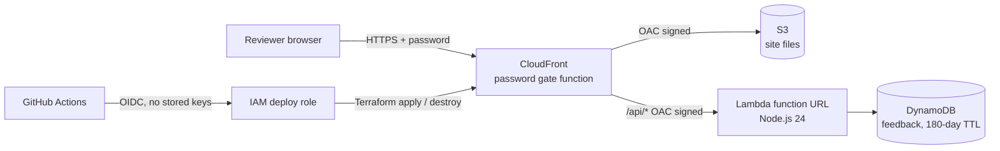
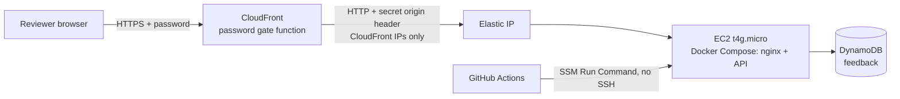

# Shart Bag: concept site and client review environments

A concept website for **Shart Bag**, a novelty shark-shaped fanny pack for bathroom emergencies, plus everything needed to put it in front of a few reviewers safely: a feedback API, a local Docker environment, CI, and two AWS environments run entirely from GitHub Actions. One is a serverless preview that is built and destroyed on demand. The other is an EC2 server with a link that never changes, switched on and off as needed.

> **About this project.** Shart Bag is my own product concept. I run it here as if it were a client engagement (brief, decisions, backlog, pull requests, a password-protected preview and a teardown) to show how I would deliver the same work for a paying client.

| | |
|---|---|
| **Client** | Shart Bag (novelty product, pre-launch) |
| **Engagement** | Concept website + review environment |
| **Delivered by** | Eric Shadwick |
| **Status** | Concept review. Not for sale. |

## What the client gets

- A one-page concept site: three bags, the "Shart Force" zipper charms, kit contents, field-test clips and a one-minute black-and-white short.
- A **feedback form** so reviewers can say which bag and charm they like and whether they would buy one.
- A **private link** behind a username and password, in one of two forms:
  - **Preview** (serverless): costs close to nothing, exists only while a review runs, and gets a new link each time.
  - **Server** (EC2): keeps the same link, starts in about 2 minutes, and stops itself every night.
- A **CSV of all feedback**, on demand or automatically when an environment is deleted.

## Architecture



The server option, with the same password gate in front of one small EC2 instance:



More detail: [docs/architecture.md](docs/architecture.md). Design decisions: [docs/adr](docs/adr).

## Run it locally

Requires Docker Desktop.

```bash
docker compose up --build
# open http://localhost:8080
docker compose down
```

The local stack runs the same site and the same Lambda handler, with nginx standing in for CloudFront and DynamoDB Local standing in for DynamoDB. Nothing touches AWS.

## Preview environment (AWS)

| Action | How |
|---|---|
| Turn it on | Actions → **Deploy preview** → Run workflow. The job summary prints the link. |
| Get feedback so far | Actions → **Export feedback** → download the CSV artifact. |
| Turn it off | Actions → **Tear down preview** → type `teardown`. Feedback is exported first, then everything is deleted. |

## Server environment (AWS EC2)

| Action | How |
|---|---|
| Create it, or ship the latest commit | Actions → **Server: create or update**. The first run takes about 15 minutes; the summary prints the link. |
| Turn it on | Actions → **Server: start** (about 2 minutes). Same link every time. |
| Turn it off | Actions → **Server: stop**. It also stops itself every night (09:17 UTC from GitHub, with a 09:30 UTC timer on the server as a backstop). |
| Get feedback so far | Actions → **Export feedback** → choose `server`. |
| Remove it for good | Actions → **Server: delete** → type `delete`. Feedback is exported first. |

First-time AWS and GitHub setup is a one-time job: see [docs/runbook.md](docs/runbook.md).

### Cost

Nothing in the preview is billed by the hour: S3, CloudFront, Lambda and DynamoDB on-demand all charge per request or per GB stored, which for a handful of reviewers comes to cents at most. After teardown, the only thing left in AWS is the Terraform state file (a few KB).

The server costs about $4.29 a month while stopped (its fixed IP and disk), plus $0.0084 for each hour it runs: about $4.37 for 10 demo hours a month, or about $10.42 if it never stopped. Details and guardrails: [ADR 0005](docs/adr/0005-ec2-server-option.md).

A monthly AWS Budget emails an alert at 20 percent of its limit and when the forecast passes it, as a backstop.

## Repository layout

```
site/            Static concept site (HTML, images, video, film page)
api/             Feedback API: Lambda handler, validation, unit tests, local server, Dockerfile
infra/bootstrap/ One-time AWS setup: state bucket, GitHub OIDC role, budget alert
infra/preview/   The preview environment: S3, CloudFront, password gate, Lambda, DynamoDB
infra/server/    The server environment: VPC, EC2, Elastic IP, CloudFront, DynamoDB, SSM parameter
deploy/server/   Host setup, deploy script, Compose file and nginx origin gate for the EC2 server
docker/          nginx config for the local stack
scripts/         Site asset check, feedback CSV export, backlog seeding
docs/            Client brief, architecture, decision records, runbook, backlog
.github/         CI; preview, server and export workflows; PR template
```

## Quality gates

Every pull request runs:

- API unit tests (`node --test`).
- A site check that every referenced file and anchor exists.
- `terraform fmt` and `validate` on all three stacks.
- A Docker Compose smoke test that serves the site and round-trips a feedback submission.
- ShellCheck on the server scripts.
- A test that the server's nginx refuses every request without the CloudFront origin secret.

The server deploy workflow also checks the live link after each deploy: no password gets 401, and the server's own IP address does not answer.

## Notes

- Product photos and lifestyle scenes are AI-generated concept renders. The finished bag may look different.
- Code and content are not licensed for reuse. All rights reserved.
