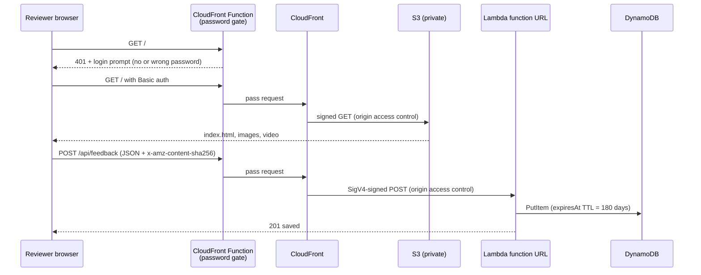

# Architecture

## Request flow

## Components

| Component | Purpose | Notes |
|---|---|---|
| S3 bucket | Holds the static site | Private. Only this CloudFront distribution can read it (OAC + bucket policy on `AWS:SourceArn`). |
| CloudFront | HTTPS, caching, single URL for site and API | `/api/*` goes to Lambda with caching disabled; everything else is cached. Price class 100. |
| CloudFront Function | Password gate | Runs on every viewer request for both behaviors. Returns 401 with a Basic auth challenge unless the header matches. |
| Lambda (Node.js 24, arm64) | Validates and stores feedback | Function URL uses `AWS_IAM` auth, so only CloudFront can call it. 128 MB, 5 s timeout. |
| DynamoDB | Feedback storage | On-demand billing. `expiresAt` TTL deletes rows after 180 days. |
| CloudWatch Logs | Lambda logs | 7-day retention. |
| IAM deploy role | Used by GitHub Actions | Trusts only this repo's `preview` environment via GitHub OIDC. Permissions scoped to `shart-bag-preview-*` resources (CloudFront is account-wide, see ADR 0003). |
| S3 state bucket | Terraform state | Versioned, encrypted, private. Native S3 state locking (`use_lockfile`). Survives teardown. |
| AWS Budget | Cost alarm | Emails at 20 percent of $5 actual spend and when the forecast passes $5. |

## Environments

| Environment | Where | Lifetime |
|---|---|---|
| Local | Docker Compose: nginx + API container + DynamoDB Local | While `docker compose up` is running |
| CI | GitHub-hosted runner, same Compose file | Per pull request |
| Preview | AWS, created by Terraform | From **Deploy preview** until **Tear down preview** |

## Why the API runs the same code everywhere

`api/src/app.js` handles a Lambda function URL event and has storage injected. In AWS, `handler.js` wires it to DynamoDB. Locally, `local-server.js` turns plain HTTP requests into the same event shape and points the same DynamoDB client at DynamoDB Local. The unit tests call `app.js` directly with a fake store.

## Security notes

- No AWS keys in GitHub: short-lived credentials from OIDC, limited to the `preview` environment.
- The site bucket and the Lambda function URL are both private; CloudFront signs every origin request.
- The shared password is a GitHub secret, injected at deploy time. It ends up inside the CloudFront Function code, so anyone with CloudFront read access in the AWS account can see it. Acceptable for a concept preview; see ADR 0002.
- The feedback form has a honeypot field, a 10 KB body limit and server-side validation. CSV export neutralizes spreadsheet formulas.
