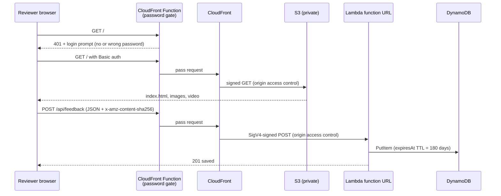
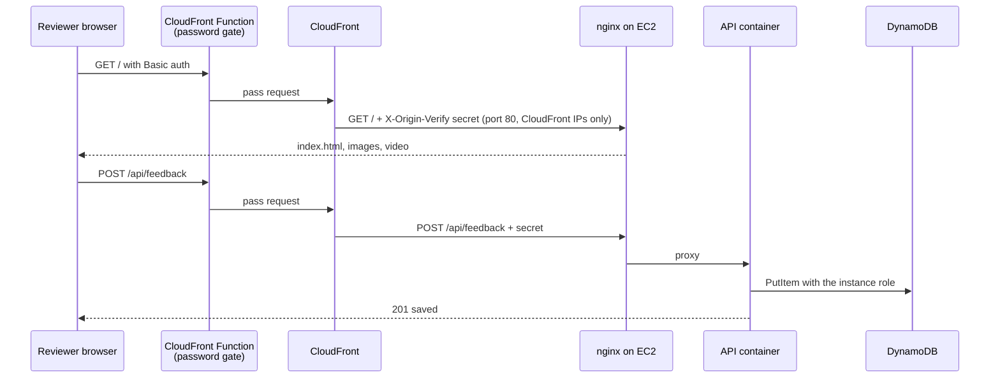

# Architecture

## Request flow

## Components

| Component | Purpose | Notes |
|---|---|---|
| S3 bucket | Holds the static site | Private. Only this CloudFront distribution can read it (OAC + bucket policy on `AWS:SourceArn`). |
| CloudFront | HTTPS, caching, single URL for site and API | `/api/*` goes to Lambda with caching disabled; everything else is cached. Price class 100. |
| CloudFront Function | Password gate | Runs on every viewer request for both behaviors. Returns 401 with a Basic auth challenge unless the header matches. |
| Lambda (Node.js 24, arm64) | Validates and stores feedback | Function URL uses `AWS_IAM` auth, so only CloudFront can call it. 128 MB, 5 s timeout. |
| DynamoDB | Feedback storage | On-demand billing. `expiresAt` TTL deletes rows after 180 days. |
| CloudWatch Logs | Lambda logs | 7-day retention. |
| IAM deploy role | Used by GitHub Actions | Trusts only this repo's `preview` environment via GitHub OIDC. Permissions scoped to `shart-bag-preview-*` resources (CloudFront is account-wide, see ADR 0003). |
| S3 state bucket | Terraform state | Versioned, encrypted, private. Native S3 state locking (`use_lockfile`). Survives teardown. |
| AWS Budget | Cost alarm | Emails at 20 percent of $5 actual spend and when the forecast passes $5. |

## Server environment (EC2)

| Component | Purpose | Notes |
|---|---|---|
| VPC and public subnet | Network for the server | Its own 10.42.0.0/16 VPC, one subnet in a zone that offers the instance type, internet gateway, no NAT gateway. |
| Security group | Firewall | Inbound: port 80 from the `com.amazonaws.global.cloudfront.origin-facing` prefix list only. No SSH. |
| Network interface + Elastic IP | Fixed address | Created before the instance so first boot already has its permanent address. |
| EC2 t4g.micro | Runs the app | Amazon Linux 2023 arm64, encrypted 8 GB gp3, IMDSv2 required (hop limit 2), `standard` CPU credits. |
| Docker Compose | App runtime | `deploy/server/compose.yml`: nginx (static site, origin secret check) and the same API image as local development. |
| SSM parameter | Origin secret | SecureString. Read by `deploy.sh` at deploy time. CloudFront sends the same value as a custom header. |
| Instance role | Server permissions | Systems Manager core policy, `PutItem` on its own table, `GetParameter` on its own secret. |
| CloudFront + password function | HTTPS, password, fixed link | Caching disabled, so reviewers always see what the server runs. Viewer headers (including the password) are not forwarded to the server. |
| DynamoDB | Server feedback | Separate table from the preview, same 180-day TTL. |

## Environments

| Environment | Where | Lifetime |
|---|---|---|
| Local | Docker Compose: nginx + API container + DynamoDB Local | While `docker compose up` is running |
| CI | GitHub-hosted runner, same Compose files | Per pull request |
| Preview | AWS serverless, created by Terraform | From **Deploy preview** until **Tear down preview** |
| Server | AWS EC2, created by Terraform | From **Server: create or update** until **Server: delete**; running only between **Server: start** and **Server: stop** |

## Why the API runs the same code everywhere

`api/src/app.js` handles a Lambda function URL event and has storage injected. In AWS, `handler.js` wires it to DynamoDB. In containers (locally and on the EC2 server), `local-server.js` turns plain HTTP requests into the same event shape; with `DYNAMODB_ENDPOINT` set it uses DynamoDB Local, otherwise the real table through the instance role. The unit tests call `app.js` directly with a fake store.

## Security notes

- No AWS keys in GitHub: short-lived credentials from OIDC, limited to the `preview` environment.
- No SSH anywhere: the server has no open admin port and no key pair; deploys go through Systems Manager.
- The server only accepts traffic from CloudFront (prefix list) carrying the origin secret (nginx), so the password gate cannot be bypassed by going to its IP address.
- The password function deletes the `Authorization` header once it has checked it, so the password is never forwarded to an origin.
- The site bucket and the Lambda function URL are both private; CloudFront signs every origin request.
- The shared password is a GitHub secret, injected at deploy time. It ends up inside the CloudFront Function code, so anyone with CloudFront read access in the AWS account can see it. Acceptable for a concept preview; see ADR 0002.
- The feedback form has a honeypot field, a 10 KB body limit and server-side validation. CSV export neutralizes spreadsheet formulas.
